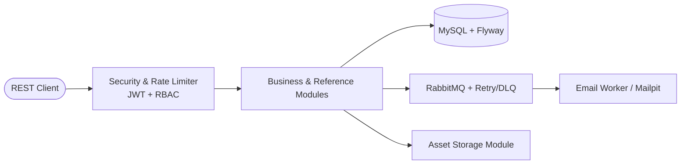

# Spring Boot Monolith Scaffold


A reusable Spring Boot foundation for building secure modular monoliths. It includes identity, role-based access, Flyway migrations, a soft-delete reference module, RabbitMQ-backed email, and an independent asset-storage module.

## Architecture Overview



## Quick Start

### 1. Start Infrastructure (MySQL, RabbitMQ, Mailpit)
```bash
docker compose up -d
```

### 2. Run the Application
**Linux / macOS:**
```bash
./mvnw spring-boot:run -Dspring-boot.run.profiles=dev
```

**Windows (PowerShell):**
```powershell
.\mvnw.cmd spring-boot:run "-Dspring-boot.run.profiles=dev"
```

* **API Base URL:** `http://localhost:8080`
* **Mailpit UI:** `http://localhost:8025`
* **RabbitMQ Management:** `http://localhost:15672`
* **Dev Admin Credentials:** `admin@localhost.com` / `admin123`

## Documentation

- [Architecture](ARCHITECTURE.md): system boundaries, request flow, persistence,
  identity, assets, messaging, and known limits.
- [Help](HELP.md): complete local setup, required configuration, testing, Flyway,
  upload guidance, and troubleshooting.
- [Permissions implementation plan](PERMISSIONS_PLAN.md): current authorization
  baseline, permission model, migration order, seeders, tests, and downstream
  crowdfunding synchronization.

The repository contains one baseline migration, `V1__initial_scaffold.sql`.
Keep the initial schema consolidated in that file until it has been applied to
a shared or production database; after that, use forward-only numbered
migrations for schema changes.

## Project principles

- Entity identity is an explicit per-entity decision.
- Audit fields, soft deletion, and business lifecycle states are separate concerns.
- Business modules own their relationships and authorization rules.
- Files are independent assets; internal storage keys are never public API values.
- Flyway is the database schema source of truth.
- Start simple, then introduce only the infrastructure a business module needs.

## Build

```powershell
.\mvnw.cmd package -DskipTests
.\mvnw.cmd test
```

See [HELP.md](HELP.md) for production configuration requirements. Never commit
secrets, local upload data, or production connection details.
